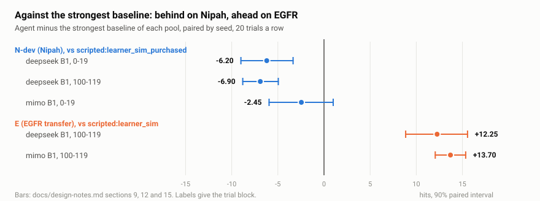
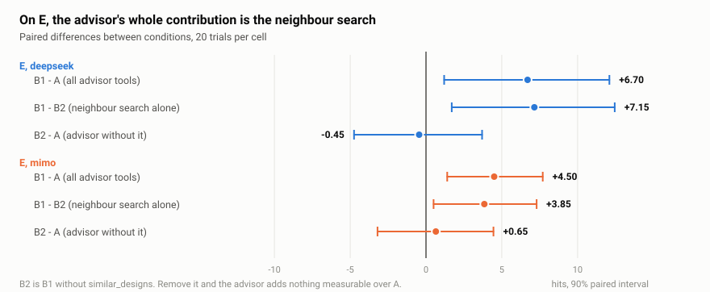

# replaylab

**A decision engine for protein design selection, validated by replaying real lab results.**

*Abstract.* Designing a protein that binds something is mostly done on a
computer; *testing* one in a wet lab costs real money and time. This project
studies an AI agent that must choose which designed proteins to test, round by
round, on a limited budget — and whether giving that agent the right tools
makes it measurably better than simple scripted rules. Using public data, we
replay real lab outcomes so that every decision can be scored honestly. The
answer we find is two-sided: the agent **loses where the scripted rules already
work**, and **wins where they break down**.



## 1. The problem

[Adaptyv API: Giving everyone access to a real lab](https://www.adaptyvbio.com/blog/adaptyv-api)
is built around agents as its primary users:

> "agents can submit experimental campaigns, retrieve results, and reason over
> them to plan the next round of designs"

An agent in that seat can reason about a campaign from its own knowledge
alone. But a language model generalizes; it does not know *your* assay, *your*
score columns, or what happened in *this* campaign last round. The question this
project sets out to answer, in that context, is: **how can we make an agent's
life easier?** Our bet: hand it specialized tools — a way to inspect the pool,
to fit a model on its own results, to follow up on its own discoveries — and it
should make more informed decisions, better than before and at lower cost than
giving it everything at once or asking it to reason harder.

## 2. The setup, in plain words

An agent conducting an experimental campaign on the platform is handed:

* a **pool of protein designs** — hundreds of computer-generated candidates,
* a handful of **computational features** for each one — predicted quality
  scores that are weakly informative and often misleading (fast computational
  estimates that rank candidates plausibly, but not reliably),
* a **budget** and a limited number of **rounds**.

Each round the agent buys a **batch** of designs; the lab reports back how many
were **hits** — designs that actually bind the intended target in the lab.
Results arrive after each purchase: sometimes
immediately, sometimes delayed, during which bought-but-unreported designs are
*pending*. The goal: **find as many hits as possible before the money runs
out** — and know when to stop early and save the rest of the budget.

## 3. The games

We turn a public dataset of real designed binders and their recorded lab
outcomes into a **game** that mimics a real campaign: the agent never sees the
outcome column — it is revealed only for designs the agent has actually bought.

Each turn the agent receives the campaign state — how much budget and how many
rounds remain, what it has bought, what is still pending, and the visible
features of the candidates (one tidy object; in the code, `CampaignState`). It
then either **uses a tool** or **submits a batch**, and receives the results at
the next time step (or, in delayed games, later). Two families of tools are
offered:

* **campaign tools** — inspect the pool and its columns, buy, wait, review
  history, stop;
* **advisor tools** — propose a batch from a scripted policy, fit a logistic
  model on what has been learned so far, find neighbours close to a hit (a
  *similarity index* is a numeric measure of how alike two protein sequences
  are), and estimate hit rates (14 tools in total).

The agent plays **against rules-based policies that see exactly the same
information**: random selection; picking by a single fixed score; and
*learners* — policies that fit a simple logistic model on their own delivered
results. The plain one is `learner`; `learner_sim` blends its ranking with
sequence similarity to the hits it has already found; a third variant
standardizes its features on what it has bought rather than on the whole pool.
"The best scripted player" (the *bar* the agent is judged against) is the best
of these policies *on the pool being played*. Because everyone reads the same
pool and the same hidden outcomes, the comparison is fair by construction.

## 4. The evaluation

The project followed a research timeline, each stage written down *before* its
data was seen:

1. **Preliminary analysis** — which score columns can be trusted (coverage,
   missingness); and whether "similarity" between designs mostly measures
   shared authorship. It partly does: sequences designed by the same author
   turned out to be statistically more similar to each other than to other
   authors' designs, so a similarity score partially reveals *who* designed a
   sequence, not only how good it is.
2. **Frozen experiment setup** — a fixed train/test split built by family
   (near-identical sequences never straddle the split), frozen feature lists,
   frozen model settings, per-episode pseudonymous ids, and criteria written in
   advance.
3. **Test on Nipah data** — the development pool, against the scripted
   policies, with two flash models and a round of prompt/tool tuning.
4. **Test on EGFR data** — the transfer set: the configuration frozen, a fresh
   block of never-played episodes, the bar set to the best scripted policy on
   that pool.
5. **Ablation tests** — removing the advisor tools (condition A) and removing
   one advisor tool (`similar_designs`, condition B2) to see what actually
   carries the result.
6. **Test on the Anthropic dataset** — *built and pre-registered; deliberately
   unplayed.* Four single-target games (Nipah-G, EGFR, BBF-14, BHRF1 — 90
   designs each, sharing no sequence with the development pools), conditions A,
   B1 and B2, both models, 20 trials, a pooled headline, every input file
   pinned by hash and each game behind a run-once lock. The parameters are
   fixed in `docs/prereg-anthropic.md` before any episode exists.

**Headline results.** On the Nipah development pool the agent **fails** to
match the best scripted player; on EGFR it **passes outright — all four
cells (each cell is one combination of LLM model and available tool set) beat
the best scripted policy** with intervals above zero; the ablations show the
win splits roughly in half between the agent's own
filtering and its advisor tools, with `similar_designs` carrying the advisor
half. Section 6 has the numbers; section 7 the caveats.

## 5. How the data is protected

Lab outcomes are the answer sheet; an agent that reads them early is not being
evaluated, it is cheating. Several independent safeguards prevent that:

* **Sealed outcomes.** Policies and advisor code receive only a read-only
  snapshot of the campaign — no writes, no outcome access beyond delivered
  results. Tools never return sequences, real identifiers, or outcomes for
  designs that were not bought *and* delivered. A test fails the build if any
  package crosses these import boundaries.
* **Anonymous, seed-dependent ids.** Agents see `d0001`-style aliases, not real
  ids; the mapping is reshuffled by every episode's seed. An agent (or a human)
  cannot join ids across runs or to outside knowledge — aliases are meaningless
  outside their own episode.
* **Reproducibility stamps.** Every run records a `config_hash` over the model,
  prices, prompts, conditions, tool descriptions and limits, plus the git
  commit. Two records with the same hash came from the same configuration — a
  claim in the results can always be traced to exactly the code that produced it.
* **Honest bookkeeping.** One append-only JSON line per finished episode;
  episodes that fail (provider error, truncated reply, spending cap) are *never*
  recorded and simply replayed — a run's record cannot be curated after the
  fact. Comparisons are paired on identical seeds, so luck of the draw cancels
  out.
* **Frozen artifacts** — splits, feature lists, model settings are committed and
  checked; the held-out fold is refused by three separate guards until the one
  final run.
* **Pre-registration.** Each experiment's question, trials and pass/fail rule
  are written down *before* the data exists, and validity gates are checked
  before any score is read.

## 6. Results

**Development pool (Nipah-G).** The best scripted player reaches **26.4 hits**
per 60 purchases (mean over 100 seeds). The agent (deepseek-flash, condition
B1) falls **6.2 hits short** (90% paired interval [−9.0, −3.35]; a
confirmatory rerun on a fresh block: −6.9 [−8.8, −4.95]) — a clear **FAIL**
against the pre-registered margin. mimo-v2.6-flash narrowly misses the same
margin. For context, the agent beats random selection decisively
(+11.9 to +14.4) and lands at parity with the plain learner policy `learner`
(+1.2 [−0.8, +3.35]) — it plays competently, it just does not beat a well-tuned
script here. A stronger frontier model was the obvious suspect: Claude Opus 5.5
could not be tested (the provider declined the requests), so the capability
probe used Claude Sonnet 5.5, which did no better (−10.4 on trials 0–9). Two
rounds of prompt/tool tuning likewise changed nothing (first iteration: no
detectable effect; second: worse and reverted). **The Nipah failure does not
appear to be a capability gap** — neither a bigger model nor more instruction
tuning closed it.

**Transfer set (EGFR).** Here the scripted policies are weak — the best of
them, `learner_sim`, averages only **~10.4 hits** — because of a *model gate*:
a policy (scripted or agent) may only fit its model once it has at least 2 hits
among at least 8 delivered purchases. Until then it cannot use its model at
all, so on this pool the scripted policies spend their first rounds blindly
fishing for hits — buying by a fixed score until the gate opens, which in our
data happens only in round 4 of 4. The whole ladder reorders between the two
pools, which is the clearest single picture of why one bar is high and the
other low:


On a fresh block of episodes with the configuration frozen, **every cell passes
and exceeds**:

| cell | agent − best scripted | 90% CI | verdict |
| --- | --- | --- | --- |
| deepseek, B1 | **+12.25** | [8.85, 15.55] | exceeds |
| deepseek, C (custom analysis tool) | +12.35 | [9.2, 15.25] | exceeds |
| mimo, B1 | **+13.70** | [12.05, 15.35] | exceeds (20/20 wins) |
| mimo, C | +11.85 | [9.1, 14.5] | exceeds |

The agent reaches ~23–24 hits (a 38–40% hit rate on a pool where only 16% of
designs bind), using two features, length and design class.

*Condition keys:* **A** — campaign tools only; **B1** — campaign + advisor
tools (the headline agent); **B2** — B1 with the similarity-lookup tool
removed; **C** — B1 with the scripted-fit tool replaced by a custom-analysis
tool (the agent fits and ranks with its own logistic regression). All
conditions share the same prompts, model and limits — they differ only in
which tools are exposed.

**Why it wins there — the mechanism.** Round 1 is a wash: neither the agent
nor the scripted policy can fit a model yet (the gate above is open for no
one), so both buy blind. The agent then builds its lead **in round 2** by
filtering the pool directly with its query tools; those early hits open *its*
model gate a full round before the scripted policy reaches the same gate (the
agent crosses the 2-hit threshold after two rounds, the scripted learner only
after four). Rounds 3 and 4 compound.


**How the agents actually play.** The transcripts show a consistent style
across every run: several dozen tool calls per campaign, most of them narrow
pool queries — filter, sort, re-query — in long chains; `describe_campaign`
before the first purchase in every episode; a model fit consulted before most
later batches. The agents prefer to **hand-pick their batches** from their own
filtered views rather than delegate: the "propose a batch" tool is used only a
handful of times per campaign. The campaign-tools-only condition shows the same
style with no advisor at all — about twelve filtered queries per episode, the
entire selection made through `query_pool` and `column_summary` — and the
differences between models show up as habits: one checks its estimated hit rate
several times per campaign, the other rarely does.

**Ablations.**



* *Campaign tools only (A):* still beats the bar — **+5.55** (deepseek) and
  **+9.2** (mimo). The cold-start escape needs no advisor at all.
* *Advisor on top (B1 − A):* **+6.7** [1.25, 12.2] and **+4.5** [1.5, 7.6] —
  the advisor roughly doubles the gain, in different halves for each model.
* *One tool removed (B1 − B2, `similar_designs` taken away):* **+7.15** and
  **+3.85** — and B2 drops back to campaign-tools level. On this pool, the
  advisor's entire measurable value is *following up on hits through the
  similarity index*; the rest of the kit is close to neutral.

**A defect in our own toolkit, and what it taught us.** Auditing the
transcripts turned up a flaw on our side rather than the model's: agents were
shown **raw** feature values while the fitted model reported its weights in
**oriented** space, and nothing stated which columns were flipped. Of the 607
pool queries that sorted on the one lower-is-better column, **113 asked for the
worst designs**, and 86 batches were submitted directly afterwards — in 39% of
EGFR episodes. Since buying the worst-scoring designs *hurts* the agent, the
EGFR win was obtained in spite of this, not because of it. We fixed the surface
and then measured the fix on a fresh block of 80 episodes: hits did not move
(pooled +0.17 [−2.70, +3.00]), and neither did the behaviour — the worst-first
rate was unchanged (+0.25 calls per episode, interval spanning zero). The old
description had already said "a lower ProteinMPNN score is better" in plain
words, and agents sorted backwards anyway, in both arms. The lesson is a design
one: a hazard in a tool is better **removed** than documented.

**The two-sided conclusion.** The agent loses where the scripted learner works
(a strong, well-fed model on a dense-signal pool) and wins where it breaks down
(a cold start it cannot escape, weak scripts, sparse clustered hits). Neither
half cancels the other: tool sets for agents should be judged by *where* they
change the game, not by a single universal scoreboard.

## 7. Limitations

* **Offline only so far.** Everything is replayed from recorded outcomes; the
  live forward mode against the real lab API is future work. Replay means the
  world never reacts to the agent — a real campaign does.
* **Few pools.** Nipah and EGFR are two targets (plus small stop-games);
  seed-level intervals measure policy luck on *one* pool, not performance across
  targets. The Anthropic dataset test, run once, is meant to be the third leg.
* **Small samples.** Each cell holds 20 paired episodes; some intervals are wide and
  one cell (mimo's confirmatory run) straddled its margin at the maximum
  planned sample.
* **Relative bars.** "Pass" means beating the *best scripted policy of that
  pool* — a high bar on Nipah (26.4), a low one on EGFR (10.4). It is not an
  absolute measure of usefulness.
* **Possibly-seen data.** Nipah and EGFR competition data is public; models may
  have seen it in training. This affects every condition equally but muddies
  absolute claims.
* **Provider variability.** Runs depend on live APIs: transient 500s (retried
  and replayed), thinking-mode cost inflation, and no sampling seed — a rerun
  is not token-for-token reproducible; the recorded file *is* the result.
* **Tuning attempts were few.** Two prompt/tool iterations were tried on the
  development pool (neither helped); this is not an exhaustive search of what
  prompting could do.
* **A known toolkit defect sits inside the played results.** Feature
  orientation was undescribed while every episode in this report was played
  (section 6); it cost the agent rather than flattered it, but the absolute
  numbers belong to a toolkit with that flaw in it.
* **Early stopping was barely exercised.** Almost every campaign ran to its
  full budget; a stopping-advice tool exists, but nothing in these results
  speaks for or against stopping early. That question is future work.

## 8. Conclusion

Tool-using agents are not uniformly better than scripted rules — they are
better *where rules cannot go*: when the start is blind, the signal is weak, or
the winning move is to adapt mid-campaign. On this evidence, the practical
takeaway for agentic lab platforms is to give agents tools that compress exactly
those gaps (inspect freely, follow up on discoveries, fit what they have
learned) rather than more raw capability. The next checks are the once-only
Anthropic dataset test and, eventually, a live campaign.

---

## For developers

```text
src/replaylab/
  domain/     core types and feature specs
  config.py   YAML configuration loading and validation
  datasets/   Proteinbase tables, 3-mer similarity/clustering, folds, aliases,
              pool loader
  store/      SQLite store: append-only campaign history
  backends/   replay backend: serves recorded outcomes to the agent
  engine/     campaign rules (clock, submit/settle/wait), scoring
  advisor/    preprocessing, logistic model, similarity index, rate/stop rules
  policies/   batch selection strategies: random, fixed metric, learner, learner_sim (+stop)
  eval/       evaluation engine
  interfaces/ the 15 tools, MCP server and CLI (the agent-facing layer)
  spec_pin.py OpenAPI spec pin
data/         data handling and processing scripts
scripts/      convenience scripts
tests/        one test file per module + import-boundary guard
```

```bash
uv sync                                    # project + dev group (pytest, ruff); without uv: pip install -e . pytest ruff
make test                                  # CI set: no data, network or key needed
make lint                                  # ruff check + format check
make test-all                              # everything, including real-data checks

# Download the Proteinbase CSV at data/raw/proteinbase.csv (gitignored), then:
python data/build_tables.py --csv data/raw/proteinbase.csv --check   # expect 15 x OK
python data/build_clusters.py --check                                # cluster summary check
python data/build_folds.py                                           # writes the frozen split
pytest -m data -q                                                    # real-data checks

# Evaluation harness
python scripts/run_ladder.py                                         # reports/ladder.{csv,md}
uv sync --extra eval                                                 # adds the LLM client extras
replaylab-eval conditions                                            # the tool set of every condition
replaylab-eval pilot --run-dir runs/x --model deepseek --games N-dev \
    --conditions A,B1 --trials 20 --max-usd 1                        # first episodes + cost projection
replaylab-eval run --run-dir runs/x --model deepseek --games N-dev \
    --conditions A,B1 --trials 20 --max-usd 1                        # plays only what is missing
replaylab-eval scripted --run-dir runs/x --games N-dev \
    --policies random,learner,learner_sim,learner_sim_purchased --trials 20
replaylab-eval compare --records runs/x/episodes.jsonl --game N-dev \
    --a B1 --b scripted:learner_sim --ci 0.9                         # paired bootstrap over seeds
replaylab-eval view --run-dir runs/x                                 # one HTML page for the run
```

`build_folds.py` refuses to overwrite a frozen split (exit code 3); pass
`--force` only if you really mean to replace it. The user guide under
`docs/user_guide/` walks through the architecture, the vocabulary, and the
evaluation workflow; `docs/design-notes.md` holds the numbers behind every
choice and every experiment's registration and results.

| document | what it holds |
| --- | --- |
| [`docs/design-notes.md`](docs/design-notes.md) | every number behind every decision, in order |
| [`docs/caveats.md`](docs/caveats.md) | the conditions these results hold under — read before quoting them |
| [`docs/prereg-anthropic.md`](docs/prereg-anthropic.md) | the final test, fixed before it is played |
| [`docs/prereg-orientation.md`](docs/prereg-orientation.md) | the toolkit-defect experiment and its null |
| [`reports/ladder.md`](reports/ladder.md) | the full scripted ladder, 100 seeds per game |
| `reports/agent_study.csv` | per-episode scores behind every figure in this README |

The figures above are generated, not pasted: `scripts/export_study.py` writes the per-episode
scores out of the run records (scores only — no transcripts, identifiers or sequences), and
`scripts/make_figures.py` redraws the SVGs from that CSV using the project's own paired
bootstrap, so a figure and `replaylab-eval compare` cannot drift apart.

```bash
python scripts/make_figures.py
```

**Definitions**

* **hit**: any binding record for the (design, target) pair is True.
* **conflict**: the binding records for the pair disagree.
* **strength**: the strongest label among the strength records (Strong, Medium, Weak).
* **kd_molar**: the smallest KD, converted to molar units; a KD with no target is attached
  to the design's only binding target, or dropped if that is ambiguous.
* Metadata (`meta_name`, `meta_author`, `meta_method`) is stored apart from features and is
  never visible to an agent.

**Output** (`data/processed/`, gitignored): `designs.parquet`,
`outcomes.parquet`, `targets.parquet`, `evaluations_long.parquet`,
`build_report.json`.
