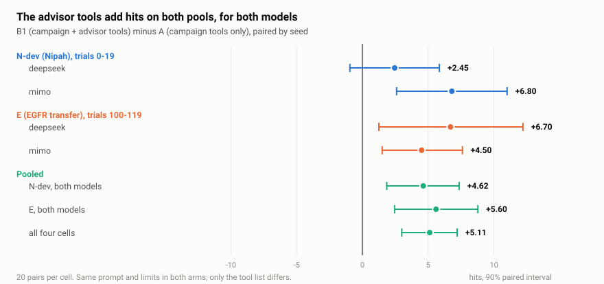
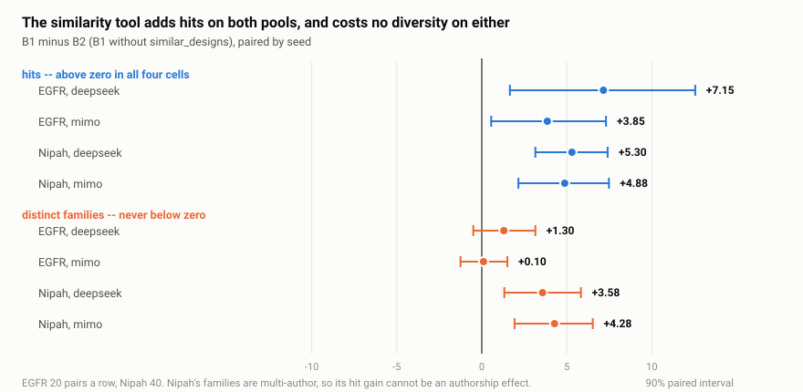

# Analysis tools help language-model agents find more protein binders

**replaylab**: an environment, an MCP toolkit and a set of baseline policies that score
protein design–test campaigns by replaying real lab outcomes.

## Summary

Lab platforms such as Adaptyv now take experiments through an API and expect AI agents to run
design–test campaigns: each round, the agent chooses which computationally designed binders to
buy for testing, on a fixed budget. These APIs let an agent read its results but leave the
analysis to the model. We asked whether a small set of analysis tools — fit a model on the
campaign's own results, find designs similar to a hit, estimate hit rates — makes an agent find
more binders than the same model with basic campaign tools alone. We built an environment that
replays public Proteinbase outcomes so that every purchase can be scored without a lab, and
compared the two tool sets on the same seeds, on two targets (Nipah-G and EGFR) and with two
inexpensive models. The tools added hits in all four model × target cells, +5.1 hits per 60
purchases pooled. Most of the gain came from one tool, a similarity lookup that lets the agent
follow up on its own hits; it does not depend on designs sharing an author and does not cost
diversity. Against hand-coded baseline policies the result is two-sided: the agent falls short
of a tuned learner on Nipah-G but beats every baseline on EGFR, where fixed rules stall at a
cold start.

**Highlights**

* Advisor tools raise the hits an agent finds by about 5 per 60 purchases.
* Following up on hits through sequence similarity carries most of that gain.
* Agents escape a cold start that traps fixed selection rules, but lose where those rules work.
* A warning written into a tool description did not change agent behavior.



> **Figure 1. Advisor tools increase hits on both targets and with both models.**
> Hits per 60 purchases, condition B1 (campaign + advisor tools) minus condition A (campaign
> tools only), paired by seed, with 90% paired bootstrap intervals; 20 trials per cell
> (Nipah-G trials 0–19, EGFR trials 100–119). The pooled estimate was computed after the fact
> (see Methods, *Choice of the primary outcome*).

## Introduction

[Adaptyv API: Giving everyone access to a real lab](https://www.adaptyvbio.com/blog/adaptyv-api)
names agents as its primary users:

> "agents can submit experimental campaigns, retrieve results, and reason over
> them to plan the next round of designs"

Such an API lets an agent submit designs and read what comes back. What it leaves to the model
is the analysis. Turning a table of predicted scores and a few dozen lab results into the next
batch is a statistical task, and a model that reasons from its built-in knowledge alone has to
do that arithmetic in its head. We hypothesized that a few purpose-built analysis tools would
let the agent make better-informed choices, and so find more binders, than a larger model or
longer reasoning would.

Testing that hypothesis requires three things. First, an environment that plays a campaign
faithfully, revealing an outcome only once a design has been bought. Second, a toolkit the
agent can call, split so that the analysis tools can be added or removed on their own. Third,
a reference that does not depend on the agent: hand-coded selection rules that see exactly what
the agent sees. We built all three and used them to run a series of pre-registered
experiments.

We find that the analysis tools help, on both targets and with both models, and that most of
their value comes from letting the agent follow up on its own hits. We also find that whether
an agent beats a fixed rule depends less on the agent than on whether the rule's assumptions
hold for the pool at hand.

## Results

### A replayed campaign scores every purchase against real outcomes

We built each campaign, or *game*, from a public dataset of designed binders and their recorded
binding outcomes (Proteinbase). The agent sees a pool of designs, a handful of fast predicted
scores for each (structure-prediction confidences and similar metrics that rank candidates
plausibly but not reliably), a budget and a number of rounds. Each round it buys a batch, and
at the end of the round the environment reveals which designs bound the target (*hits*). The
goal is to find as many hits as possible. Outcomes stay sealed until a design has been bought
and delivered (see Methods).

Two games carry the results. **Nipah-G** (687 designs, about 10% hits, seven score columns) was
our development pool; **EGFR** (826 designs, about 16% hits, two score columns) served as a
transfer test, played only after the configuration was frozen. Both run for 4 rounds of 15
purchases.

We exposed the environment to the agent over MCP as two families of tools. **Campaign tools**
let it inspect and query the pool, buy, wait and review its history. **Advisor tools** let it
fit a logistic model on its own results, find the designs most similar to a hit, request a batch
from a baseline policy and estimate hit rates. Our main comparison pairs condition **A**
(campaign tools only) with condition **B1** (campaign plus advisor tools), with the same model,
prompt and seeds. As a reference we also played six hand-coded **baseline policies** on the
same seeds, from random selection to logistic-regression learners that fit on their own results
once they have seen at least 2 hits among 8 purchases (the *model gate*; see Methods).

### Advisor tools increase the number of hits an agent finds

Giving the agent advisor tools raised its hit count in every cell (Figure 1). On Nipah-G,
B1 found 2.45 (deepseek-flash) and 6.80 (mimo-v2.6-flash) more hits per 60 purchases than A on
the same seeds; on EGFR it found 6.70 and 4.50 more. Three of the four 90% paired intervals
exclude zero, and the fourth points the same way. Pooled over the four cells, the advisor tools
added **5.1 hits** (90% interval about [3.0, 7.2]).

### The agent loses to a tuned learner on Nipah-G but beats every baseline on EGFR

We next compared the agent with the strongest baseline of each pool (Figure 2). On Nipah-G that
baseline, `learner_sim_purchased`, finds 26.4 hits on average. The agent fell short by 6.2 hits
(deepseek, trials 0–19) and by 6.9 hits in a confirmatory rerun on fresh trials (90% interval
[−8.8, −4.95]); mimo missed narrowly (−2.45 [−5.95, +1.0]). The agent still played well: it beat
random selection by 14 to 18 hits and matched or exceeded the plain `learner`. Neither a
stronger model (Claude Sonnet 5.5, −10.4 on trials 0–9) nor two rounds of prompt and tool tuning
closed the gap.

On EGFR the picture reversed. With the configuration frozen and on never-played trials, every
agent cell exceeded the strongest baseline there, `learner_sim` (about 10.4 hits), by 11.9 to
13.7 hits. The agents reached 23–24 hits in 60 purchases, a 38–40% hit rate in a pool where 16%
of designs bind, using only two predicted-score columns.

> **Figure 2. Against the baseline policies, the result depends on the pool.**
> Agent minus the strongest baseline of each pool, paired by seed, with 90% paired intervals.
> Nipah-G: deepseek B1 on trials 0–19 (−6.20) and on confirmatory trials 100–119 (−6.90); mimo
> B1 (−2.45). EGFR, trials 100–119: deepseek B1 +12.25 [8.85, 15.55]; mimo B1 +13.70
> [12.05, 15.35], ahead in all 20 trials. Condition C, which replaces the fit tool with a
> configurable one, gave the same picture (+12.35 and +11.85; Methods).


### Fixed rules stall at a cold start that the agent escapes

Why do the two pools disagree? Until the model gate opens, a baseline learner buys the top of
the pool by one predefined score column. On Nipah-G that fallback finds 5 hits in round 1, the
gate opens for round 2 and the learners are strong. On EGFR the same fallback finds 1 hit in
round 1 and none in round 2, so the gate opens only for round 4 of 4: the learners spend almost
the whole campaign without a model. As a result, the ranking of the baselines inverts between
the two pools (Figure 3A); the best policy on Nipah-G is the worst on EGFR, where even random
selection beats the plain learner.

The agent escapes that cold start (Figure 3B). Round 1 is blind for everyone. In round 2 the
agent filters the pool with its query tools instead of following a single column, finds its
first hits and passes the model gate by the end of the round (6.9 hits on average for B1). It
can then fit a model from round 3, a round earlier than the baseline, and rounds 3 and 4
compound the lead.

> **Figure 3. The baselines' ranking inverts at a cold start, which the agent escapes.**
> (A) Mean hits per baseline policy on Nipah-G and EGFR (100 seeds each). The best policy on
> Nipah-G, `learner_sim_purchased` (26.4), is the worst on EGFR (4.5), where `random` (9.6)
> beats `learner` (7.4). (B) Cumulative hits at each round boundary on EGFR. The baseline stays
> near one hit through rounds 1–2 and reaches 10.6 by round 4; B1 reaches 22.8 and A 16.1.


### Following up on hits through sequence similarity carries the tool effect

To find what carries the EGFR result, we removed tools one set at a time (Figure 4). With
campaign tools alone (A), the agent already beat the strongest baseline, by 5.55 (deepseek) and
9.2 hits (mimo): escaping the cold start needs no advisor. Adding the advisor tools (B1) gained
a further 6.7 and 4.5 hits, so roughly half the agent's lead comes from its own judgment and
half from the tools. Removing a single advisor tool, the similarity lookup `similar_designs`
(condition B2), cost 7.15 and 3.85 hits and brought B2 back to the level of A. On this pool, the
advisor tools help almost entirely by letting the agent follow up on its hits.

This works because hits cluster. On EGFR, 16.2% of designs bind, but within a sequence family
that already contains a hit, 42.7% do, a 2.6-fold lift (Nipah-G: 34.8% against 10.0%). Asking for
the neighbors of a hit and buying them harvests families whose odds are already known to be
good.

> **Figure 4. On EGFR, the similarity lookup accounts for nearly all of the advisor effect.**
> Paired differences in hits per 60 purchases, with 90% intervals. B1 − A: +6.70 (deepseek),
> +4.50 (mimo). B1 − B2 (B1 without `similar_designs`): +7.15, +3.85. B2 − A straddles zero
> on both models.


### The similarity tool's value does not rest on authorship, and does not cost diversity

Two concerns follow from this mechanism. First, sequence families may reflect *who* made a
design as much as how it binds: on EGFR a design's nearest neighbor shares its author 74.3% of
the time (4.7% expected by chance), and two authors account for 180 of 826 designs. Following up
on a hit might then exploit one author's design pipeline rather than a shared binding mode.
Second, concentrating purchases around hits could trade away diversity: EGFR agents end with
5.2–6.7 distinct families, against 7.5 for random selection.

We tested both concerns with a pre-registered ablation on Nipah-G, where no such author series
exists: its hit-containing families average 11.2 authors and none comes from a single author.
We compared B1 with B2 on 40 fresh trials per arm and scored both hits and distinct families
(Figure 5). The similarity tool added about 5 hits on Nipah-G (deepseek +5.30 [+3.15, +7.40]),
as large as on EGFR, so authorship is not the mechanism. And removing the tool never raised the
number of families found: the difference was positive on Nipah-G and near zero on EGFR. The
diversity deficit on EGFR is largest in condition A, which has no similarity tool at all; it
comes from chasing hits with whatever tools are at hand, which is what a hit-count objective
rewards.

These results show that the tool exploits a real property of the pools, that hits cluster in
sequence space. They do not show that the agent learns sequence–activity relationships; nothing
here distinguishes exploiting a neighborhood from understanding one.

> **Figure 5. The similarity tool adds hits without authorship and without reducing
> diversity.** B1 − B2 on hits and on distinct sequence families, with 90% paired intervals.
> EGFR (20 trials): hits +7.15 and +3.85, families +1.30 and +0.10. Nipah-G (40 trials): hits
> +5.30 and +4.88, families +3.58 and +4.28. The deepseek cell on Nipah-G is the registered
> result; the mimo cell is descriptive (Methods).



### Agents query the pool and pick batches by hand

The transcripts show one style of play across models and conditions. An agent makes several
dozen tool calls per campaign, most of them narrow pool queries chained together (filter, sort,
re-query); it describes the campaign before its first purchase and fits a model before most
later batches. It builds its batches by hand from these filtered views and rarely asks a
baseline policy for a proposal. Condition A plays the same way without the advisor, through
about twelve filtered queries per episode.

### A warning in a tool description did not change agent behavior

Reading the transcripts also exposed a flaw in our own toolkit. One score column, the
ProteinMPNN score, is better when lower. The fit tool flipped its sign internally and reported
a positive weight, which against the raw values reads as "higher is better"; the query tool
sorted in descending order by default, which returned the worst designs first. Across 350
episodes, 113 of 607 queries sorting on ProteinMPNN asked for the worst designs first, and the
agents often bought straight from those views. The damage concentrated on EGFR, which has only
two score columns (39% of episodes affected, against 6% on Nipah-G). Buying the worst designs
costs hits, so the agent earned its EGFR result despite this defect.

We fixed the tool outputs and tested the fix against the old toolkit in a pre-registered
experiment whose first criterion was a manipulation check: did the fix reduce worst-first
queries? It did not, so by our registered rule the hit counts cannot speak to whether the fix
helps. The old tool description had already warned in plain words that lower ProteinMPNN scores
are better, yet in both arms about 20% of ProteinMPNN sorts still targeted the worst designs. A
warning the agent must read and recall at the right moment does not reliably change what it
does; a hazard in a tool is better removed than documented.

## Discussion

We asked whether analysis tools help a language-model agent run a protein design campaign. On
two targets and with two models, they do: the same model with advisor tools found about five
more binders per 60 purchases. Most of that gain came from a single capability, following up
on hits through sequence similarity, and it held on a pool where similarity cannot stand in for
authorship.

Compared with fixed selection rules, the agent is not better everywhere. A fixed rule wins when
its assumptions hold: on Nipah-G, the first sort column finds hits at once, the learner fits a
model from round 2, and a well-tuned learner beats the agent. The agent wins when a fixed rule
gets stuck: on EGFR, the first column finds almost nothing, the baselines cannot fit until the
last round, and the agent, which can change strategy after every result, escapes the cold start.
Because the ranking of the baselines inverts between pools, the strongest baseline is known only
in hindsight, which is why we lead with the tool contrast, a comparison that needs no such
oracle.

Our results come with several limits. Everything is replayed offline: the pool is fixed, every
design has an outcome and results arrive on schedule, unlike a live campaign. Two targets are
not a survey of targets, and seed-level intervals measure luck within one pool. Each cell holds
20 paired episodes (40 in the authorship ablation), so some intervals are wide. The baselines
are a reference rather than the best possible script; a fallback that spread early purchases
across sequence families might close much of the agent's lead on EGFR. We scored hits only; an
objective based on distinct binding families might rank the players differently. Models may
have seen the public Nipah and EGFR competition data during training, which affects every
condition equally but weakens absolute claims. Finally, all played episodes predate the fix
described in the last section, and early stopping, although supported, was barely exercised.

These findings suggest that agentic lab platforms might gain more from giving agents analysis
tools — free inspection of the pool, follow-up on discoveries, a model fitted on what has been
learned — than from more raw model capability. We have built and pre-registered a once-only test
on four further targets from an independent dataset, with the tool contrast B1 − A as its
primary outcome; it will confirm or refute these results on fresh data. A live campaign against
the lab API would follow.

## Methods

### Campaign environment

A game fixes the target, the pool of candidate designs, the budget, the number of rounds and
the reporting delay (`config/games.yaml`). Each turn the agent sees the campaign state (budget
and rounds left, purchases, pending results) and either calls a tool or submits a batch. A
design that has been bought but not yet reported is *pending* and cannot be bought again. Nipah-G
(`N-dev`) and EGFR (`E`) both run 4 rounds of 15 purchases and report at the end of each round.
Further games (a delayed-reporting variant of Nipah-G and several early-stopping games) were
used for the baseline ladder only.

### Data and feature selection

Outcomes come from Proteinbase. A design counts as a hit if any binding record for the
(design, target) pair is positive (see *Data definitions* below). We kept a score column if at
least 90% of designs had a value, and dropped it if the hit rate among designs with a value
differed from that among designs without one by more than 5 percentage points. The second rule
catches a *missingness leak*, in which the gaps rather than the values predict the outcome: a
metric is often computed only for designs that reached some stage of a pipeline. The
structure-comparison columns failed this rule (1.6% hits among scored designs against 17.4%
among unscored ones; coverage about 20%) and were excluded.

The visible features per target are fixed in `config/features.yaml`: for Nipah-G, Boltz-2 ipTM,
ipSAE, min-ipSAE and pLDDT, Boltz-2 binder shape complementarity, ESMFold pLDDT and the
ProteinMPNN score; for EGFR, ESMFold pLDDT and the ProteinMPNN score. Sequence length and
design class are visible in every game.

### Development split

We cut Nipah-G into three folds with a stratified group k-fold, which groups designs into
sequence families by 3-mer similarity, keeps every family in one fold and balances hits across
folds. Two folds form the development pool `N-dev`; the third is held out for a single final
run and is refused by three separate guards until then.

### Tools and conditions

The toolkit holds eight campaign tools and six advisor tools, exposed over MCP. A fifteenth
tool is used by condition C only. Conditions differ only in which tools the agent receives; they
share the prompt, model and limits.

| condition | tools |
| --- | --- |
| **A** | campaign tools only |
| **B1** | campaign + advisor tools (the main agent) |
| **B2** | B1 without `similar_designs`, the similarity lookup |
| **C** | B1 with `fit_and_rank` replaced by `fit_custom_model`, which lets the agent set up its own logistic regression |

Agents see pseudonymous design ids (`d0001`, …) reshuffled by each episode's seed. We used two
inexpensive models, `deepseek-flash` and `mimo-v2.6-flash`; Claude Sonnet 5.5 was tested on
Nipah-G trials 0–9 only, and Claude Opus 5.5 could not be tested because the provider declined
the requests.

### Baseline policies

The baselines see exactly what the agent sees and choose a batch each round; in the run records
they appear as `scripted:<policy>`.

1. **`random`**: a uniform draw from the designs not yet bought.
2. **`fixed:<column>`**: the top of the pool by one score column, every round.
3. **`learner`**: an L2 logistic regression (C = 0.1, lbfgs, no class weights) fitted on its
   own delivered results; it buys the designs with the highest predicted hit probability and
   draws 20% of each batch at random to keep exploring. It fits only after at least 2 hits
   among at least 8 delivered purchases (the *model gate*). Below 2 hits only one class is
   present and the fit is undefined; the 8-purchase floor is a judgment call against fitting
   on a handful of rows. Until the gate opens it falls back to `fixed:<first_column>`, named per
   target before the experiments (`boltz2_ipsae` for Nipah-G, `esmfold_plddt` for EGFR).
4. **`learner_sim`**: as `learner`, but it ranks designs by the average of two ranks, predicted
   probability and sequence similarity to the hits so far (weight 0.5).
5. **`learner_purchased`** and 6. **`learner_sim_purchased`**: as the two above, but they
   standardize features on the designs bought so far rather than on the whole pool.

We chose all model settings on `N-dev` only (`config/frozen_v1.yaml`). The agent's
`fit_and_rank` tool applies the same model gate.

*Why the purchased-scaling variants help on Nipah-G and hurt on EGFR.* `learner_sim_purchased`
gains 11.9 hits over `learner_sim` on Nipah-G and loses 5.9 on EGFR (100 seeds each). Both
effects hold up elsewhere: +8.7 on the delayed Nipah-G game, +6.3 on an earlier legacy game,
−2.6 on EGFR over 8 rounds. We have not tested the cause; a plausible one has three steps.

1. The model is fitted only on the designs bought so far. Those were mostly picked from the
   top of one score column, so they span a narrow range of that score.
2. The L2 penalty acts on standardized features. Pool-wide scaling measures that narrow range
   in units of the whole pool, where it looks small, so the score's weight is shrunk hard.
   Purchased scaling stretches the narrow range to unit spread, so the weight survives.
3. When the model then ranks the whole pool, a surviving weight on the score dominates the
   ranking. That helps on Nipah-G, where the Boltz-2 scores carry signal (AUC 0.61 to 0.68).
   It hurts on EGFR, where the only fit uses 45 designs bought by ESMFold pLDDT, a score with
   almost no signal there (AUC 0.54). The design class, which the model also sees (unscaled,
   as one-hot columns), separates EGFR hits far better: from 3% hits among miniproteins to
   46% among scFvs.

The numbers behind each step are in `docs/design-notes.md` sections 6 and 8 and
`reports/feature_signal.csv`.

### Experimental sequence and pre-registration

We ran the experiments in a fixed sequence and wrote down each stage's question, trials,
decision rule and validity gates before playing its episodes:

1. *Preliminary analysis*: feature coverage, missingness leaks and what similarity measures.
2. *Frozen setup*: split, features, model settings and decision rule, committed before any
   agent episode.
3. *Development* on Nipah-G: agents against baselines with both models, and two rounds of prompt
   and tool tuning (the first had no detectable effect; the second made results worse and was
   reverted). A confirmatory rerun of deepseek B1 used fresh trials 100–119.
4. *Transfer* to EGFR with the configuration frozen, on fresh trials 100–119. No cell was
   inconclusive, so the registered extension to trials 120–139 was not played.
5. *Ablations*: conditions A and B2 on EGFR; the authorship ablation (B1 vs B2) on Nipah-G
   ([`docs/prereg-authorship.md`](docs/prereg-authorship.md)); and the orientation fix
   ([`docs/prereg-orientation.md`](docs/prereg-orientation.md)).
6. *Final test* on the Anthropic dataset: built and pre-registered, deliberately not yet played.
   Four single-target games (Nipah-G, EGFR, BBF-14, BHRF1; 90 designs each, no sequence shared
   with the development pools), conditions A, B1 and B2, both models, 20 trials, a pooled
   headline, every input file pinned by hash and each game behind a run-once lock
   ([`docs/prereg-anthropic.md`](docs/prereg-anthropic.md)).
7. *Held-out test* on Nipah-G fold 2 (`N-held`, 343 designs no development game ever played):
   pre-registered, not yet played. Conditions A, B1 and B2, both models, 40 trials, under the
   same run-once lock and the same frozen configuration as the final test
   ([`docs/prereg-heldout.md`](docs/prereg-heldout.md)).

Every trial block was played once; a new idea uses a fresh block of seeds.

### Choice of the primary outcome

We registered the Nipah-G and EGFR experiments with a different primary outcome: the agent
against the strongest baseline of each pool, judged by a 90% paired interval against a 2-hit
margin. We declared the tool contrast B1 − A before its data existed in every case, but as a
secondary, descriptive comparison without a pass/fail rule, and computed the pooled figure over
the four cells afterwards. Because the ranking of the baselines inverts between pools (Figure 3A),
the strongest baseline can be named only in hindsight, whereas the tool contrast needs no such
oracle and is the question the project set out to answer. We therefore lead with it. This
changes the presentation, not the numbers: apart from the pooled figure, every value reported
comes from a comparison declared before its episodes were played. The unplayed final test
registers B1 − A as its primary outcome (amendment of 2026-11-01).

### Statistical analysis

We paired every comparison by seed and summarized it with a 90% paired bootstrap interval over
20 trials per cell (40 in the authorship ablation). Pairing gives both arms the same pool,
outcomes and presentation order, but does not remove the model's own sampling noise, which no
provider lets us seed ([`docs/caveats.md`](docs/caveats.md) entry 6). Baseline reference values
are means over 100 seeds. Validity gates (all episodes finished, configuration hash as
registered, no code change) were checked before any score was read.

In the authorship ablation, the mimo cell on Nipah-G failed a completeness gate (one episode hit
the turn limit at 45 of 60 purchases), so it is reported as descriptive; dropping that pair moves
its hit difference to +4.74 [+1.92, +7.41] (`docs/design-notes.md` section 18).

### Similarity, families and authorship

Sequence families come from 3-mer similarity, not from structural comparison. On Nipah-G, a
design's nearest neighbor shares its author 44.7% of the time (0.7% by chance; 51.6% among pairs
of hits). On EGFR the figures are 74.3% (4.7% by chance) and 79.8% among pairs of hits, over the
564 and 84 pairs in which both authors are known. Only 60 of EGFR's 499 families contain a hit,
and those families average 5.2 designs. Hits per family are 1.13–1.23 on Nipah-G against
3.10–4.22 on EGFR, which is why more hits almost mechanically means more families on Nipah-G.
No tool exposes author metadata to the agent.

### Orientation defect and fix

Before fitting, the model multiplies lower-is-better columns by −1, so a positive weight always
means "higher value, higher hit probability". The agent saw raw values and was not told which
columns had been flipped. Across all 350 recorded episodes, 607 pool queries sorted on
ProteinMPNN; 113 asked for the worst designs first (descending, with no bounding filter) and 86
batches were submitted straight afterwards. The fix makes each column report
`higher_is_better`, reports fit weights in the raw-value direction and adds a prompt warning. We
tested it against a worktree at the pre-fix commit on EGFR trials 140–159 (80 episodes). The
manipulation check failed (+0.25 worst-first queries per episode, interval spanning zero), and
hits did not differ (pooled +0.17 [−2.70, +3.00]). The fix left the worst-first default sort in
place.

### Keeping the outcomes sealed

* *Structural access control.* A single function reads the outcome table; the replay backend
  holds outcomes privately and releases one only when its design has been bought and delivered.
  Tools and baselines work from read-only snapshots that contain delivered outcomes only. A test
  parses every module's imports and fails the build if a package imports one it may not.
* *Response schemas.* Every tool response is a declared schema that cannot carry sequences, real
  identifiers or undelivered outcomes, and dedicated tests check this.
* *Configuration fingerprints.* Every run records a hash over the model, prices, prompts,
  conditions, tool descriptions and limits, plus the git commit.
* *Append-only logs.* One JSON line per finished episode, never edited. Failed episodes are not
  recorded and are replayed, so a run cannot be curated after the fact.
* *Frozen artifacts.* Splits, feature lists and model settings are committed and checked on
  every run.

### Data and code availability

All code, configuration and pre-registrations are in this repository. Per-episode scores behind
every figure are in `reports/agent_study.csv`; the figures are regenerated from it by
`scripts/make_figures.py`. The full baseline ladder is in [`reports/ladder.md`](reports/ladder.md),
and every number behind every decision is in [`docs/design-notes.md`](docs/design-notes.md).
Read [`docs/caveats.md`](docs/caveats.md) before quoting the results.

---

## For developers

```text
src/replaylab/
  domain/     core types and feature specs
  config.py   YAML configuration loading and validation
  datasets/   Proteinbase tables, 3-mer similarity and clustering, folds, aliases,
              pool loader
  store/      SQLite store: append-only campaign history
  backends/   replay backend: serves recorded outcomes to the agent
  engine/     campaign rules (clock, submit/settle/wait), scoring
  advisor/    preprocessing, logistic model, similarity index, rate and stop rules
  policies/   batch selection: random, fixed metric, learner, learner_sim (+stop)
  eval/       evaluation harness: agent loop, runner, spend guard, comparisons
  interfaces/ the 15 tools, MCP server and CLI (the agent-facing layer)
  spec_pin.py OpenAPI spec pin
data/         scripts that build the processed tables, clusters and split
scripts/      ladder, figures, exports and other convenience scripts
tests/        one test file per module, plus the import-boundary guard
```

```bash
uv sync                                    # project + dev group (pytest, ruff); without uv: pip install -e . pytest ruff
make test                                  # CI set: no data, network or key needed
make lint                                  # ruff check + format check
make test-all                              # everything, including real-data checks

# Download the Proteinbase CSV to data/raw/proteinbase.csv (git-ignored), then:
python data/build_tables.py --csv data/raw/proteinbase.csv --check   # expect 15 x OK
python data/build_clusters.py --check                                # cluster summary check
python data/build_folds.py                                           # writes the frozen split
pytest -m data -q                                                    # real-data checks

# Evaluation harness
python scripts/run_ladder.py                                         # reports/ladder.{csv,md}
uv sync --extra eval                                                 # adds the LLM client extras
replaylab-eval conditions                                            # the tool set of every condition
replaylab-eval pilot --run-dir runs/x --model deepseek --games N-dev \
    --conditions A,B1 --trials 20 --max-usd 1                        # first episodes + cost projection
replaylab-eval run --run-dir runs/x --model deepseek --games N-dev \
    --conditions A,B1 --trials 20 --max-usd 1                        # plays only what is missing
replaylab-eval scripted --run-dir runs/x --games N-dev \
    --policies random,learner,learner_sim,learner_sim_purchased --trials 20
replaylab-eval compare --records runs/x/episodes.jsonl --game N-dev \
    --a B1 --b scripted:learner_sim --ci 0.9                         # paired bootstrap over seeds
replaylab-eval view --run-dir runs/x                                 # one HTML page that replays the run
```

`build_folds.py` refuses to overwrite a frozen split (exit code 3); pass `--force` only if you
really mean to replace it.

The figures in this README are generated, not pasted. `scripts/export_study.py` extracts the
per-episode scores from the run records (scores only: no transcripts, identifiers or
sequences), and `scripts/make_figures.py` redraws the SVGs from that CSV with the project's own
paired bootstrap, so a figure cannot drift from what `replaylab-eval compare` reports.

```bash
python scripts/make_figures.py
```

### Testing on a new dataset

A new pool needs two tables, two config entries and nothing else. The Anthropic pools were
added this way (`datasets/anthropic.py` with `scripts/build_anthropic.py` is a worked example).

1. **Write the tables** to a directory of your own, for example `data/processed/mypool/`:
   * `designs.parquet`: one row per design, with `design_id`, `sequence`, `design_class` (may
     be empty) and one column per score you want to expose;
   * `outcomes.parquet`: one row per (design, target), with `design_id`, `target`, `hit`
     (bool), `strength` and `kd_molar` (may be empty), `n_records`, `n_true` and `conflict`.
2. **Declare the features** in `config/features.yaml` under your target id: the visible
   columns, `higher_is_better: false` on every column where lower is better, and a
   `first_column` for the baseline learners' fallback. Choose these before looking at
   outcomes.
3. **Declare a game** in `config/games.yaml`: target, `split: all` (or `dev` with a folds
   file), rounds, batch size, budget and, optionally, `delay_rounds`.
4. **Check it with the baselines first**, which costs nothing:

```bash
uv run replaylab run-scripted --policy learner_sim --game MY-GAME --seed 0 --tables data/processed/mypool
```

```bash
uv run python scripts/run_ladder.py --game MY-GAME --seeds 100 --tables-dir data/processed/mypool --out-csv runs/my-ladder.csv --out-md runs/my-ladder.md
```

   (Without `--out-csv` and `--out-md` the ladder overwrites the committed `reports/ladder.*`.)

5. **Play it with an agent.** Fill in `config/models.yaml` and `config/prices.yaml` from the
   `.example` files (check every price on the provider's own pages), then run `pilot` and
   `run` with `--games MY-GAME --tables data/processed/mypool`, as in the commands above, and
   `compare` B1 against A. Optionally build sequence families with `data/build_clusters.py`
   for the distinct-family score, and folds with `data/build_folds.py --target <id>` for a
   held-out split.

If you mean the new pool as a confirmatory test, write the analysis plan down before the first
episode and mark the game `final_test: true`, which puts it behind the run-once lock
(`eval/final_run.py`).

### Adding a tool or a policy

* **A tool:** a method on `Toolbox` in `interfaces/tools.py` with a response model in
  `interfaces/schemas.py`, a closure in `interfaces/server.py`, and its name in one of the tool
  groups at the top of `tools.py`. Expose it through a new condition in
  `config/conditions.yaml` (conditions are tool allow-lists), then refresh and review the tool
  snapshot with `pytest tests/test_mcp_server.py --update-tool-snapshot`. New tools must keep
  the leak rules that `tests/test_tools_leaks.py` checks.
* **A baseline policy:** a class with `choose(state, k, rng) -> list[str]` in `policies/`,
  registered in `policies/factory.py` (`make_policy`, `POLICY_NAMES`), and in
  `eval/ladder.py` if the ladder should run it.

[`docs/code-tour.md`](docs/code-tour.md) shows where each of these sits in the call path.

### Further reading

| document | what it holds |
| --- | --- |
| [`docs/code-tour.md`](docs/code-tour.md) | entry points, call paths, and the order to read the modules in |
| [`docs/user_guide/`](docs/user_guide/) | architecture, vocabulary and the evaluation workflow |
| [`docs/walkthrough.md`](docs/walkthrough.md) | a hands-on session on the real tables |
| [`docs/design-notes.md`](docs/design-notes.md) | every number behind every decision, plus each experiment's registration and results |
| [`docs/caveats.md`](docs/caveats.md) | the conditions these results hold under; read before quoting them |
| [`docs/prereg-anthropic.md`](docs/prereg-anthropic.md) | the final test, fixed before it is played |
| [`docs/prereg-heldout.md`](docs/prereg-heldout.md) | the held-out Nipah-G test, fixed before it is played |
| [`docs/prereg-orientation.md`](docs/prereg-orientation.md) | the toolkit-defect experiment and its null result |
| [`docs/prereg-authorship.md`](docs/prereg-authorship.md) | whether the similarity tool rides authorship, fixed before it was played |
| [`reports/ladder.md`](reports/ladder.md) | every baseline policy, 100 seeds per game |
| `reports/agent_study.csv` | the per-episode scores behind every figure |

### Data definitions

* **hit**: any binding record for the (design, target) pair is true.
* **conflict**: the binding records for the pair disagree.
* **strength**: the strongest label among the strength records (Strong, Medium, Weak).
* **kd_molar**: the smallest KD, converted to molar. A KD with no target is attached to the
  design's only binding target, or dropped if that is ambiguous.
* Metadata (`meta_name`, `meta_author`, `meta_method`) is stored apart from the features and
  is never visible to an agent.

**Output** (`data/processed/`, git-ignored): `designs.parquet`, `outcomes.parquet`,
`targets.parquet`, `evaluations_long.parquet`, `build_report.json`.

## License

The code is MIT; see [LICENSE](LICENSE).

The data the games replay comes from [Proteinbase](https://proteinbase.com), published by
Adaptyv Bio under the Open Data Commons Attribution License (ODC-BY). The raw data is not part
of this repository. The files built from it that are committed here -- `data/splits/`
(clusters, folds, the held-out ids) and the results under `reports/` -- are not covered by the
MIT license and stay under ODC-BY.

This work used Proteinbase by Adaptyv Bio under ODC-BY license.
