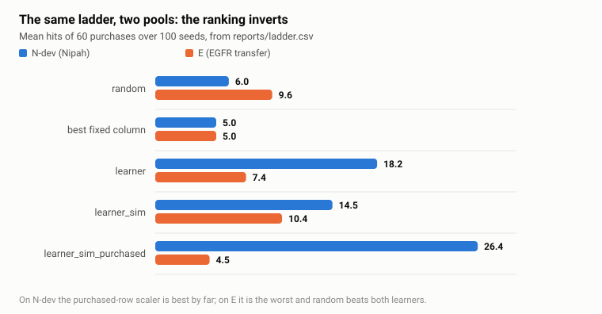
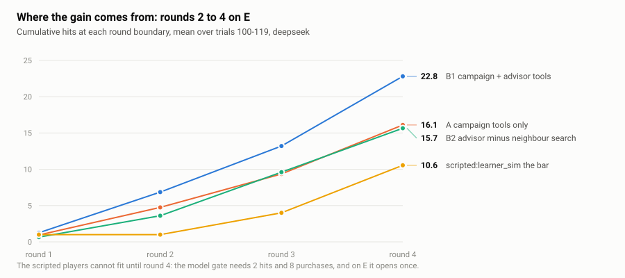

# replaylab

**A campaign decision engine for protein design selection — and a way to check whether an
LLM agent actually helps.**

Given a pool of computationally designed binders with predicted scores, which designs should
you buy for lab testing, round by round, within a budget? replaylab answers that offline by
*replaying* real lab results from Adaptyv Bio's open Proteinbase data: outcomes stay hidden
until a design is bought, so a strategy has to earn its hits the way a real campaign would.

The honest pitch: this is an **environment**, a **toolkit** (15 MCP tools) and a **ladder of
scripted baselines** that together make *"does an LLM agent add anything?"* a checkable
question. The agent is one player, not the point. If it loses to a scripted policy, that is a
legitimate finding — and on one of the two pools, it does.

---

## The result


**The answer is two-sided: the agent loses where the scripted learner works, and wins where
it breaks down.** Both halves were pre-registered — the decision rule, the bar, the seeds and
the validity gates were written down before the trials were played — and both are kept.

| | pool | agent − bar | 90% interval | W/L/T |
|---|---|---|---|---|
| **N-dev** (Nipah-G) | ~1,100 designs | **−6.90** vs `learner_sim_purchased` | [−8.80, −4.95] | 2/17/1 |
| **E** (EGFR transfer), deepseek | ~1,340 designs | **+12.25** vs `learner_sim` | [+8.85, +15.55] | 17/3/0 |
| **E** (EGFR transfer), mimo | ~1,340 designs | **+13.70** vs `learner_sim` | [+12.05, +15.35] | 20/0/0 |

On N-dev the agent is no better than a plain scripted `learner` (+1.20 [−0.80, +3.35]) though
far better than random (+13.75 [+12.00, +15.55]). A stronger model (Sonnet 5.5), two rounds of
tool-description tuning, and a condition that let the agent configure its own logistic model
all failed to close the gap. That is a **NO-GO**, recorded as such.

### Why the two pools disagree



The scripted ladder needs 2 hits and 8 delivered purchases before it can fit a model. On
N-dev that gate opens early and the scripted learner is strong. On E it opens in **one round
out of four**, and the ladder inverts: the best scripted policy on N-dev
(`learner_sim_purchased`, 26.4 hits) is the *worst* on E (4.5), and plain `random` (9.6) beats
`learner` (7.4).



The agent's advantage is a **cold-start** advantage. The scripted players sit flat at ~1 hit
through rounds 1–2 because they cannot fit yet; the agent is already selecting on the features
in round 2 and compounds from there.

### What the tools are actually worth


Conditions are tool allow-lists over one shared system prompt: **A** = campaign tools only
(8), **B1** = campaign + advisor tools (14), **B2** = B1 minus `similar_designs` (13).

On E, **the advisor's entire measurable contribution is the neighbour search.** Removing that
one tool costs as much as removing the whole advisor (B1−B2 ≈ B1−A), and what remains adds
nothing detectable over no advisor at all (B2−A straddles zero on both models). That fits the
cold-start story: where the fit gate rarely opens, the fitting tools have little to do, and
what pays is chasing sequence neighbours of the hits you already have.

| | deepseek | mimo |
|---|---|---|
| B1 − A (all advisor tools) | +6.70 [+1.25, +12.20] | +4.50 [+1.50, +7.60] |
| B1 − B2 (neighbour search alone) | +7.15 [+1.65, +12.55] | +3.85 [+0.55, +7.30] |
| B2 − A (advisor without it) | −0.45 [−4.70, +3.90] | +0.65 [−3.15, +4.45] |

### A finding about the toolkit, not the model

Auditing the transcripts turned up a defect in our own tool surface: the agent saw **raw**
feature values but the model fitted on **oriented** ones, and nothing said which columns were
flipped. Of 607 `query_pool` calls that sorted on the one lower-is-better column, **113 asked
for the worst designs**, and 86 batches were submitted straight after one. It is now fixed —
the tools report each column's `higher_is_better`, and weights are expressed in the raw-value
direction — but the played results carry it. The direction matters: buying the worst-scoring
designs *hurts* the agent, so E's win was obtained **despite** it. See
[`docs/caveats.md`](docs/caveats.md) entry 4.

---

## How it is kept honest

The point of the project is that the numbers above are hard to fool yourself with.

- **Pre-registration.** The decision rule, the bar, the margin, the seeds and the validity
  gates are written down before the trials run ([`docs/design-notes.md`](docs/design-notes.md)
  §9, [`docs/prereg-anthropic.md`](docs/prereg-anthropic.md)). Seen trials are never reused: a
  new idea gets a fresh trial block.
- **Paired by seed.** The episode seed depends only on game and trial — never on condition or
  model — so every condition plays the same pools and comparisons are paired.
- **No leaks, enforced by tests.** Tool responses never carry sequences, real design ids, or
  an outcome for a design that was not bought. `tests/test_import_boundaries.py` proves
  `advisor` and `policies` cannot even *see* the store or a backend.
- **Held-out and final-test guards.** A guarded game refuses to load its own outcomes outside
  its single final run, and refuses a second run via a committed lock file.
- **Mutation-minded tests.** New behaviour gets a test that fails without it; guards and
  builders are checked by deliberately breaking them. 939 tests, `ruff` clean.
- **Costs are capped**, with a spend ledger, a pilot projection and a hard cap checked before
  every model call.

## Architecture

```text
src/replaylab/
  domain/      pure types and rules (standard library only)
  config.py    YAML loaders (games, features) with no silent defaults
  datasets/    Proteinbase + Anthropic tables, splits, clusters, similarity
  store/       SQLite campaign store (append-only event log)
  backends/    replay backend: serves recorded outcomes, hides the rest
  engine/      campaign rules (submit / settle / wait), scoring
  advisor/     preprocessing, logistic model, similarity, hit-rate, stop advice
  policies/    the scripted ladder (random, fixed_metric, learner, learner_sim, ...)
  interfaces/  schemas, the 15 tools, MCP server, CLI
  eval/        agent loop, matrix runner, spend guard, scorers, statistics, CLI
```

Import boundaries are enforced, not documented: `domain` imports only the standard library,
`advisor` and `policies` receive a `CampaignState` snapshot and nothing else, and **nothing**
imports `interfaces` or `eval`.

## Quickstart

```bash
uv sync          # or: pip install -e . pytest ruff
make test        # 939 tests, no data, network or API key needed
make lint
```

To work with the real data, download the Proteinbase CSV to `data/raw/proteinbase.csv`
(git-ignored), then:

```bash
python data/build_tables.py --csv data/raw/proteinbase.csv --check
python data/build_clusters.py --check
python data/build_folds.py
pytest -m data -q
```

Play the scripted ladder, then an agent, then compare them:

```bash
python scripts/run_ladder.py
```

```bash
replaylab-eval scripted --run-dir runs/r1 --games E --policies random,learner,learner_sim --trials 20
```

```bash
replaylab-eval run --run-dir runs/r1 --model deepseek --games E --conditions A,B1 --trials 20 --max-usd 20
```

```bash
replaylab-eval compare --records runs/r1/episodes.jsonl --game E --a B1 --b scripted:learner_sim --ci 0.9
```

`replaylab-eval view --run-dir runs/r1` writes an offline replay of the episodes you can click
through. Real runs need an API key and real values in `config/models.yaml` /
`config/prices.yaml` (copy the `.example` files and check every number against the provider's
own pages — nothing about a provider is decided in code).

Regenerate this README's figures from the committed CSVs:

```bash
python scripts/make_figures.py
```

## Status

Phases 0–7 are built and integrated: the environment, the toolkit, the scripted ladder, the
evaluation harness and the agent study above. The **final test** — the Anthropic binder
release, 1,320 designs over 15 targets that share no sequence with Proteinbase — is **built,
pre-registered and deliberately unplayed**: four single-target games behind a run-once lock, a
pinned input hash, and a rehearsal copy with shuffled column names and drawn labels so the
whole pipeline can be exercised without spending the test. See
[`docs/prereg-anthropic.md`](docs/prereg-anthropic.md).

Still open: the live Foundry-API backend (forward mode), and a knowledge layer whose shape
should follow from the ablation above rather than precede it.

## Where things are documented

| File | What it holds |
|---|---|
| [`docs/design-notes.md`](docs/design-notes.md) | every number behind every decision, in order |
| [`docs/caveats.md`](docs/caveats.md) | the conditions these results hold under — read before quoting them |
| [`docs/prereg-anthropic.md`](docs/prereg-anthropic.md) | the final test, fixed in advance |
| [`reports/ladder.md`](reports/ladder.md) | the full scripted ladder, 100 seeds per game |
| `reports/agent_study.csv` | per-episode scores behind every figure |
| [`CLAUDE.md`](CLAUDE.md) | the working handoff: status, frozen decisions, rules of engagement |

## Definitions

* **hit** — any binding record for the (design, target) pair is True. On the Anthropic pool,
  the release's own two-vendor binder call.
* **conflict** — the binding records for a pair disagree.
* **strength** — the strongest label among the strength records (Strong, Medium, Weak).
* **kd_molar** — the smallest dissociation constant, in molar units, never rounded; a KD with
  no target is attached to the design's only binding target, or dropped if ambiguous.
* Metadata (`meta_name`, `meta_author`, `meta_method`) is stored apart from features and is
  never visible to an agent.

Processed tables land in `data/processed/` (git-ignored): `designs.parquet`,
`outcomes.parquet`, `targets.parquet`, `evaluations_long.parquet`, `build_report.json`.
